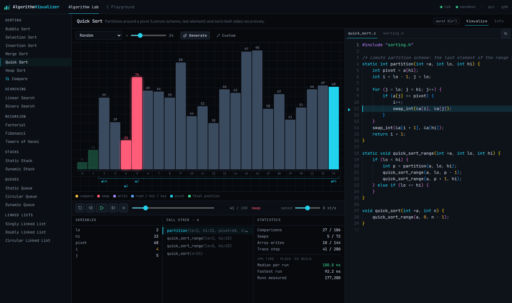
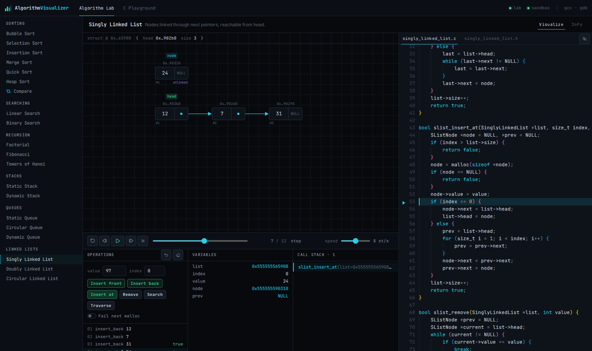
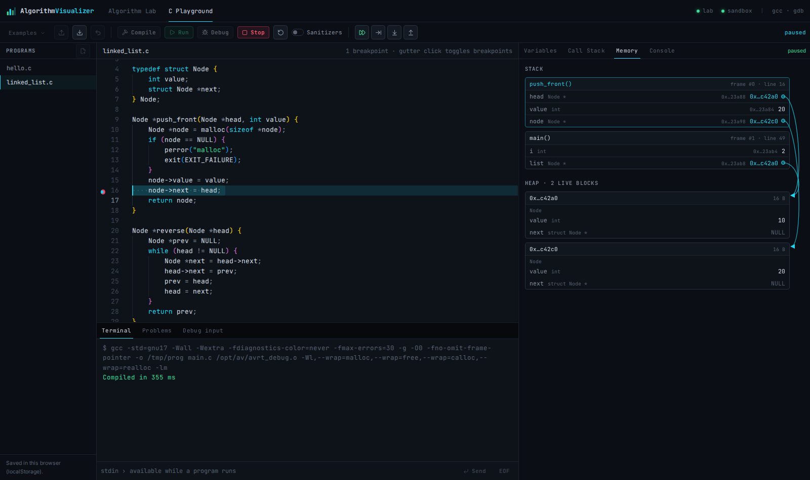

# Algorithm Visualizer

[](https://github.com/monolith-preacher/algorithm-visualizer/actions/workflows/ci.yml)
[](LICENSE)

An interactive laboratory for algorithms, data structures and memory, built around **C**.

- **Algorithm Lab** — a library of algorithms and data structures written in C. Every animation is derived from the execution of the real C implementation: the instrumented program emits a structured trace, and the UI replays it next to the source code, the call stack and the live variables.
- **C Playground** — an in-browser editor for your own C programs. Code is compiled with **GCC** and executed inside an isolated **Docker** sandbox; the visual debugger drives **GDB/MI** to step through the program and inspect variables, the call stack, the stack frames and the heap.



| Linked list insertion (real heap addresses) | GDB-based memory view |
| --- | --- |
|  |  |

## Features

### Algorithm Lab

| Module | Implementations (C) | Visualization |
| --- | --- | --- |
| Sorting | Bubble, Selection, Insertion, Merge, Quick (Lomuto), Heap | Animated bars with compare / swap / write / pivot / final-position states, auxiliary buffer for Merge Sort, active sub-range, index markers |
| Searching | Linear, Binary | Probed cell, live interval `[lo, hi]`, discarded cells, match / not-found state; the binary search precondition is checked in C |
| Recursion | Factorial, Fibonacci, Towers of Hanoi | Call tree with arguments and return values, call stack, animated pegs and disks |
| Stacks | Static (array), Dynamic (linked nodes) | Array slots with `top`; heap nodes with addresses and `next` pointers |
| Queues | Static (linear), Circular, Dynamic | `front` / `rear` markers, ring buffer with modulo wrap-around, linked nodes |
| Linked lists | Singly, Doubly, Circular (tail-addressed) | Nodes, `next` / `prev` arrows, back edge of the ring, local pointer variables attached to the nodes they point to |

- **Synchronized C source.** The code panel shows the actual file that was compiled. The line that produced the current step is highlighted; instrumentation lines can be shown or hidden.
- **Step history.** Play, pause, step forward/back, reset, scrub and speed control (keyboard: <kbd>Space</kbd>, <kbd>←</kbd>, <kbd>→</kbd>, <kbd>Home</kbd>, <kbd>End</kbd>). Stepping back shows a previously recorded state; nothing is "executed in reverse".
- **Inputs.** Random, ascending, descending, nearly sorted and few-unique arrays, custom values, any size up to 100; data-structure operations with value/index arguments and an option to make the next `malloc` return `NULL`.
- **Honest metrics.** Comparisons, swaps, array writes and auxiliary writes are counted from trace events and shown only where the algorithm performs them. CPU time is measured separately on an uninstrumented `-O2` build (median of many runs), independent from the animation speed.
- **Side-by-side comparison** of two sorting algorithms on the same input.
- **Technical reference** (complexities, properties, implementation notes) in a separate Info tab — no narration during playback.

### C Playground

- Monaco editor with C highlighting, auto-indentation, bracket matching, GCC diagnostics as inline markers and a Problems list.
- Programs stored in the browser (localStorage), several files, examples, import/export of `.c` files.
- **Compile**, **Run**, **Debug**, **Stop**, **Reset**; optional AddressSanitizer + UndefinedBehaviorSanitizer for runs.
- Terminal with stdout, stderr, compiler output, exit status, signals, CPU time and limits; interactive **stdin** (line input and EOF).
- **GDB debugger** (GDB/MI): breakpoints from the editor gutter, Continue, Pause, Step Over, Step Into, Step Out (with the returned value), stop on signals such as `SIGSEGV` at the faulting line.
- Panels: **Variables** (arguments, locals, globals; structs/arrays expandable; changed values highlighted), **Call Stack** (selectable frames), **Memory** (stack frames, heap blocks, pointer arrows, freed blocks, dangling pointers) and **Console** (evaluate C expressions in the selected frame).

## How it works

```
                 ┌──────────────────────── apps/web (React + Vite) ────────────────────────┐
                 │  Algorithm Lab: trace → step model (packages/shared) → visualizers       │
                 │  C Playground: Monaco · terminal · debugger panels (WebSocket)           │
                 └───────────────┬──────────────────────────────────────┬──────────────────┘
                     REST /api/lab/*                          WebSocket /ws/playground
                 ┌───────────────▼──────────────────────────────────────▼──────────────────┐
                 │                     apps/server (Node.js + TypeScript)                   │
                 │  LabRunner: spawns clib/build/avlab (traced) and avbench (plain -O2)     │
                 │  Playground: compile → run (avrun) / debug (GDB/MI client + inspector)   │
                 └───────────────┬──────────────────────────────────────┬──────────────────┘
                                 │ no shell, argv only                  │ docker run (per operation)
                     ┌───────────▼───────────┐          ┌───────────────▼────────────────────────┐
                     │ clib/ (repository C)  │          │ sandbox image: gcc, gdb, avrun, avrt   │
                     │ algorithms + TRACE_*  │          │ --network none, read-only rootfs, uid  │
                     │ → JSON-lines trace    │          │ 65534, no capabilities, cgroup limits  │
                     └───────────────────────┘          └────────────────────────────────────────┘
```

**Lab traces.** Each algorithm in `clib/src` is ordinary C plus `TRACE_*` statements on lines of their own (see [`clib/include/av_trace.h`](clib/include/av_trace.h)). The traced build emits one JSON event per operation (comparison, swap, write, call, return, step, `malloc`, `free`…), with the watched local variables and, for data structures, a snapshot of the structure read from memory. The front end replays these events into a list of immutable steps; the final replayed state is checked against the result computed by C. Compiling without `AV_TRACE` removes all instrumentation; that build is used for timing and for the sanitizer unit tests. Details: [docs/trace-format.md](docs/trace-format.md), [docs/architecture.md](docs/architecture.md).

**Playground.** Sources are compiled *inside* the sandbox (`gcc` reads the code from stdin, the binary is streamed back), then run in a fresh container under `avrun`, a small supervisor that applies resource limits and reports the exit status, signal, CPU time and peak memory. Debug sessions run `gdb --interpreter=mi3` in the sandbox; the server's inspector builds each snapshot from GDB variable objects and from an allocation table maintained by `malloc`/`free` wrappers linked into debug builds. Security model: [docs/security.md](docs/security.md).

## Requirements

- Linux (developed and tested on Ubuntu 24.04; WSL2 works)
- Node.js **≥ 20.19** (22 LTS recommended) and npm
- GCC and GNU Make (`build-essential`) — for the Algorithm Lab C library
- Docker Engine — for the C Playground (the Lab works without it); your user must be able to run `docker` (e.g. member of the `docker` group)

## Quick start

```bash
git clone https://github.com/monolith-preacher/algorithm-visualizer
cd algorithm-visualizer
scripts/setup.sh            # npm install, build clib, build the sandbox image
npm run dev                 # API on :3001, web app on http://127.0.0.1:5173
```

On a fresh Ubuntu machine, `scripts/setup.sh --system-deps` installs `build-essential`, `gdb` and `make` with apt first.

Production-style run (single port, the server serves the built client):

```bash
npm run build
npm start                   # http://127.0.0.1:3001
```

## Commands

| Command | Description |
| --- | --- |
| `npm run dev` | Build `clib`, start the API (tsx watch) and Vite with live reload |
| `npm run build` | Build `clib`, the server bundle and the web client |
| `npm start` | Start the built server (serves `apps/web/dist`) |
| `npm test` | C unit tests (ASan/UBSan/LSan) + TypeScript tests |
| `npm run test:c` | `make -C clib test`: unit tests and sanitizer trace smoke test |
| `npm run test:ts` | Vitest: trace replay vs. C results, parsers, models |
| `npm run test:sandbox` | Integration tests against Docker (compile errors, signals, limits, isolation, GDB sessions) |
| `npm run lint` / `npm run typecheck` | ESLint / TypeScript checks |
| `npm run build:sandbox` | Build the sandbox image |
| `scripts/sandbox.sh build\|rebuild\|status\|clean\|remove` | Manage the sandbox image and leftover containers |

## Docker

The application itself runs on the host; Docker is used only for the sandbox in which user programs are compiled, executed and debugged. No compose file or long-running container is needed: the server starts one short-lived container per compile, run or debug session and removes it afterwards.

```bash
scripts/sandbox.sh build      # build algoviz-sandbox:latest (also done by setup.sh)
scripts/sandbox.sh rebuild    # rebuild from scratch, pulling a fresh ubuntu:24.04
scripts/sandbox.sh status     # image info and running sandbox containers
scripts/sandbox.sh clean      # remove leftover sandbox containers
```

If Docker is missing or the image has not been built, the server keeps running: the Lab works, the Playground shows the reason and the `sandbox` indicator in the top bar turns red.

## Configuration

All settings are optional environment variables (or a `.env` file at the repository root, see [`.env.example`](.env.example)): host/port, allowed WebSocket origins, Docker binary and image, concurrent sandboxes, and the limits applied to user programs (`AV_CPU_SECONDS`, `AV_WALL_SECONDS`, `AV_MEMORY_MB`, `AV_PIDS`, `AV_OUTPUT_KB`, `AV_SOURCE_KB`, `AV_DEBUG_IDLE_SECONDS`).

## Project structure

```
clib/                     C library (the identity of the project)
  include/av_trace.h      instrumentation macros (compiled out without AV_TRACE)
  src/trace/              trace runtime (JSON-lines events, heap block registry)
  src/{sorting,searching,recursion,stacks,queues,lists}/   algorithm implementations
  driver/avlab.c          runs an algorithm on stdin input and emits its trace
  driver/avbench.c        timing driver for the uninstrumented build
  tests/                  unit tests (ASan + UBSan + LSan, malloc failure injection)
sandbox/                  Dockerfile, avrun (supervisor), avrt (stdout + allocation tracker)
packages/shared/          catalog, protocol types, trace → step models (used by web and tests)
apps/server/              Express + ws: Lab runner, sandbox, compiler, executor, GDB/MI debugger
apps/web/                 React + Vite + Tailwind: Lab visualizers and the Playground IDE
docs/                     architecture, trace format, security notes, screenshots
scripts/                  setup, dev and sandbox helpers
```

## Tests

- **C** (`npm run test:c`): every sorting algorithm against `qsort` on hundreds of random, sorted, reversed, duplicate, negative and empty inputs; search edge cases and randomized binary search; recursion closed forms; stacks/queues overflow, underflow and wrap-around; randomized list operations against a reference model with structural invariant checks (`prev`/`next` symmetry, ring closure); injected `malloc` failures. Built with AddressSanitizer, UndefinedBehaviorSanitizer and LeakSanitizer. The instrumented driver is also run under the sanitizers for every algorithm.
- **TypeScript** (`npm run test:ts`): replaying each trace reproduces the array/structure computed by C; operation counts match closed forms (e.g. bubble sort on reversed input performs n(n−1)/2 comparisons and swaps); instrumentation never leaves empty blocks in the clean view; GDB/MI parser, compiler diagnostics, status-record filter.
- **Sandbox** (`npm run test:sandbox`, needs Docker): compile errors with line numbers, warnings, exit codes, stdin, `SIGSEGV`, `SIGFPE`, CPU limit, wall-clock limit, output limit, process limit, no network, read-only filesystem, unprivileged user, memory exhaustion, sanitizer reports, and complete GDB sessions (breakpoints, stepping, step out with return value, heap block typing, expression evaluation, signal stop, interrupting a running loop).

## Limitations

- **Debugger I/O.** During a debug session the program reads stdin from the *Debug input* tab (prepared before starting) and its stdout/stderr are shown together; interactive stdin is available in Run mode.
- **Memory view scope.** Heap blocks are known exactly (address, size, live/freed) only for allocations made by the program's own code through `malloc`/`calloc`/`realloc`/`free`, up to 1024 allocation records per session (the view reports when the table is full). A block is shown with a type only when a typed pointer in scope refers to its start. Data reachable only through untyped (`void *`) pointers or pointer arithmetic is shown as untyped. Structures are never guessed.
- **Multithreading** is not supported by the debugger UI (only thread 1 is inspected).
- **Lab inputs** are bounded to keep animations readable (arrays up to 100 elements, Fibonacci n ≤ 12, Hanoi ≤ 10 disks, 16 nodes per structure).
- **Public deployment.** The sandbox is a solid base for local use; exposing the Playground on the internet requires further hardening (see [docs/security.md](docs/security.md)): authentication/rate limiting, a stricter seccomp profile, gVisor or a VM-level isolation layer, and resource quotas per user.
- Trees, graphs, hashing, dynamic programming and backtracking are intentionally out of scope for V1; the catalog and trace model are designed so new modules can be added without changing the rest of the system.

## License

[MIT](LICENSE)
